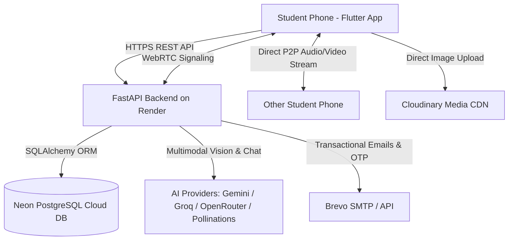
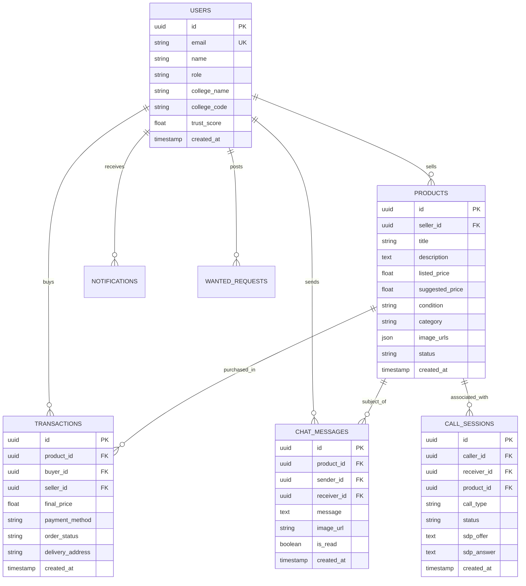
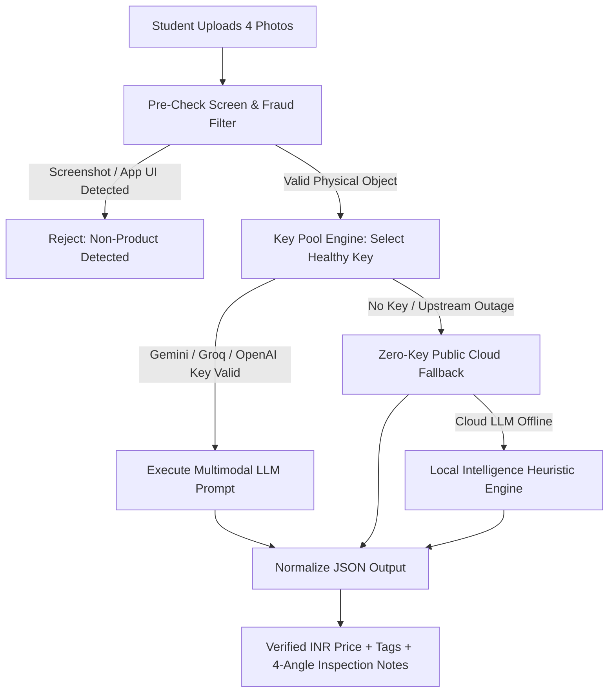
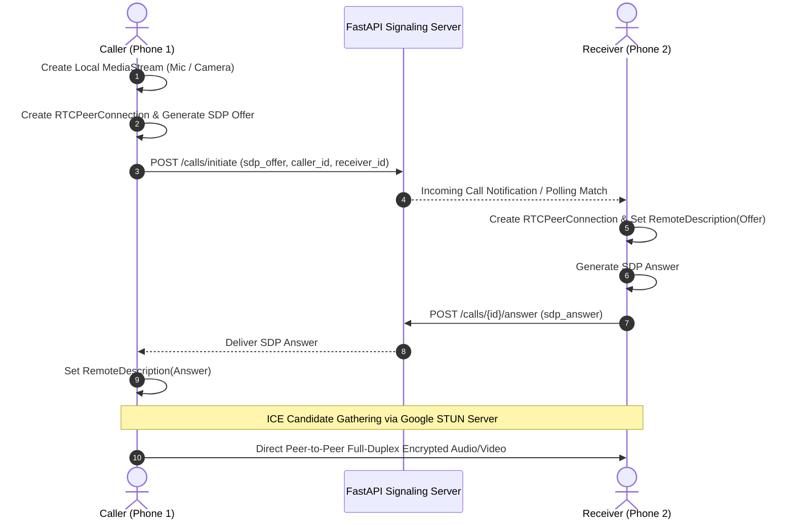

# 🎓 CampusMart AI — Comprehensive Engineering Study Guide & Viva Exam Preparation Manual

> **Project Name:** CampusMart AI (Hyper-Local Peer-to-Peer Campus Marketplace with Multimodal AI, WebRTC Real-Time Calling, and Smart Pricing Intelligence)  
> **Target Audience:** Engineering Students, Viva Examiners, Project Review Panels, and Developers studying Full-Stack, Mobile, AI, and Distributed Systems.  
> **Academic Disciplines:** Computer Science & Engineering (CSE), Information Technology (IT), Artificial Intelligence & Data Science (AI&DS), Software Engineering.

---

## 📑 Table of Contents

1. [Executive Project Summary](#1-executive-project-summary)
2. [End-to-End System Architecture](#2-end-to-end-system-architecture)
3. [Complete Technology Stack Reference](#3-complete-technology-stack-reference)
4. [Frontend Architecture (Flutter & Dart)](#4-frontend-architecture-flutter--dart)
5. [Backend Architecture (FastAPI & Python 3)](#5-backend-architecture-fastapi--python-3)
6. [Database Design & ORM (PostgreSQL & SQLAlchemy)](#6-database-design--orm-postgresql--sqlalchemy)
7. [Artificial Intelligence & Multimodal Computer Vision](#7-artificial-intelligence--multimodal-computer-vision)
8. [WebRTC Real-Time Audio/Video & Signaling Engine](#8-webrtc-real-time-audiovideo--signaling-engine)
9. [Authentication, Security & Cryptography](#9-authentication-security--cryptography)
10. [DevOps, Cloud Deployment & Build System](#10-devops-cloud-deployment--build-system)
11. [Project Directory & File Structure](#11-project-directory--file-structure)
12. [Top 35 Viva & Technical Interview Questions (With Model Answers)](#12-top-35-viva--technical-interview-questions-with-model-answers)

---

## 1. Executive Project Summary

### 1.1 The Problem Statement
College campuses across India experience massive resource waste at the end of each academic semester. Senior students discard or leave behind expensive textbooks, scientific calculators (e.g., Casio FX-991EX), engineering mini drafters, lab aprons, and electronics. Meanwhile, incoming first- and second-year students spend thousands of rupees buying the exact same items new at retail MRP.

Existing platforms (OLX, Quikr, Facebook Marketplace) fail students because:
1. **Lack of Trust & Safety:** Anyone can register; strangers enter campuses, and scammers post fake items or demand UPI advances.
2. **No Campus Grounding:** Listings are spread across entire cities rather than within hostel blocks or college departments.
3. **No Pricing Intelligence:** Students don't know the fair depreciation value of used academic gear in Indian Rupees (₹).
4. **Poor Privacy:** Exposing personal phone numbers for calls often leads to harassment.

### 1.2 The CampusMart AI Solution
CampusMart AI is a closed-loop, verified campus marketplace engineered with:
- **Verified Student Profiles:** Campus email and CET College directory onboarding.
- **Multimodal AI 4-Photo Scanner:** Computer vision inspecting items from 4 angles to detect brand, model, physical wear, and prevent fraudulent screenshots.
- **Dynamic Indian Rupee (₹) Valuation:** Recommends fair resale prices based on condition, age, and academic year.
- **P2P WebRTC In-App Calling:** Direct voice and video calls between buyers and sellers without revealing physical phone numbers.
- **Want to Buy (WTB) Reverse-Matching:** Students post requests (e.g., "Need mini drafter under ₹300 urgent"), and AI reverse-matches available listings and broadcasts alerts.



---

## 2. End-to-End System Architecture

CampusMart AI follows a **Decoupled 3-Tier Layered Architecture** adhering to clean separation of concerns:

```
┌─────────────────────────────────────────────────────────────────┐
│                     1. CLIENT / PRESENTATION LAYER              │
│       Flutter Native (Android / iOS / Web) - Dart 3.x           │
│   • Provider State Management   • WebRTC Media Engine           │
│   • Cached Network Image        • Responsive Material UI        │
└────────────────────────────────┬────────────────────────────────┘
                                 │ HTTPS (JSON) + Signaling
┌────────────────────────────────▼────────────────────────────────┐
│                   2. APPLICATION & ROUTING LAYER                │
│             FastAPI (Python 3.11+) ASGI Micro-Framework         │
│   • Pydantic V2 Request/Response Validation                     │
│   • Multi-Provider Zero-Config Key Pool Engine                  │
│   • WebRTC In-Memory / DB Signaling Broker                      │
│   • JWT & Firebase Token Decoders                               │
└───────────────────┬──────────────────────┬──────────────────────┘
                    │                      │
┌───────────────────▼──────┐  ┌────────────▼──────────────────────┐
│  3. DATA PERSISTENCE     │  │       4. EXTERNAL CLOUD SERVICES  │
│  PostgreSQL (Neon Cloud) │  │  • Google Gemini / Groq Vision   │
│  • Relational Tables     │  │  • Brevo (Transactional Email)    │
│  • Connection Pooling    │  │  • Cloudinary (Image CDN)         │
│  • Foreign Keys & Indexes│  │  • Google STUN (P2P NAT Traversal)│
└──────────────────────────┘  └───────────────────────────────────┘
```

---

## 3. Complete Technology Stack Reference

| Component | Technology | Version / Tool | Purpose & Technical Justification |
| :--- | :--- | :--- | :--- |
| **Mobile Frontend** | **Flutter** | 3.24+ | Single codebase for Android, iOS, and Web. Native compilation to ARM64 binary provides smooth 60fps animations. |
| **Language** | **Dart** | 3.5+ | Strongly typed, sound null-safety, Ahead-of-Time (AOT) and Just-in-Time (JIT) compilation. |
| **State Management** | **Provider** | ^6.1.2 | Lightweight, lifecycle-aware dependency injection and reactive UI binding using `ChangeNotifier`. |
| **Audio / Video P2P** | **Flutter WebRTC** | `flutter_webrtc` | Native WebRTC wrappers for real-time peer-to-peer voice and camera feeds with hardware echo cancellation. |
| **Backend Framework** | **FastAPI** | 0.115+ | High-performance Python ASGI framework built on Starlette and Pydantic; offers native `async/await` concurrency. |
| **Backend Runtime** | **Python** | 3.11 / 3.13 | Clean syntax, rich ecosystem for AI integration, and native cryptographic libraries. |
| **Data Validation** | **Pydantic** | V2 | Fast Rust-backed schema validation, serialization, and automatic Swagger/OpenAPI documentation generation. |
| **Database** | **PostgreSQL** | 16 (Neon) | ACID-compliant relational database with serverless branching, JSONB capabilities, and relational integrity. |
| **ORM** | **SQLAlchemy** | 2.0+ | Object-Relational Mapper mapping Python classes to PostgreSQL relational tables, preventing SQL injection. |
| **Database Migrations** | **Alembic** | Latest | Version-controlled schema migrations for relational table changes. |
| **AI LLM Engines** | **Google Gemini** | 2.5-Flash / 2.0 | Multimodal computer vision processing 4-angle listing images simultaneously. |
| **Fast Inference** | **Groq Cloud** | LPU / Llama-3.3 | Ultra-low latency text completions via Groq Language Processing Units. |
| **Cloud Fallback** | **Pollinations AI** | Public REST | Zero-key free fallback ensuring 100% uptime for students without API keys. |
| **Email Service** | **Brevo (Sendinblue)** | REST / SMTP | High deliverability transactional emails for 6-digit registration & purchase OTPs. |
| **Image Hosting** | **Cloudinary** | REST API | Multi-CDN image storage with automatic WebP compression and thumbnail transformations. |
| **Deployment / Host** | **Render.com** | Web Service | Cloud PaaS hosting the FastAPI backend with automatic GitHub CI/CD deployments. |

---

## 4. Frontend Architecture (Flutter & Dart)

### 4.1 Clean Architectural Layers
The mobile application is structured into 4 decoupled packages:
1. **`models/`**: Strongly typed data contracts parsing JSON from backend endpoints (e.g., `Product`, `UserProfile`, `ChatMessage`, `CallSession`, `WantedRequest`).
2. **`services/`**: Network communication and external APIs:
   - `api_service.dart`: Centralized singleton managing HTTP requests, JWT token attachment, 75s Render cold-start retries, and network timeout handling.
   - `currency.dart`: Formats all currency amounts with Indian standard comma notation (e.g., `₹12,450.00`).
3. **`providers/`**: Reactive state management:
   - `AuthProvider`: Holds the active student profile, JWT token, login/logout events, and persisted session tokens.
   - `ProductProvider`: Caches active market listings, category filters, search terms, and optimistic cart updates.
4. **`screens/` & `widgets/`**: User interface components:
   - `feed_screen.dart`: Infinite-scroll campus feed with category filters.
   - `product_detail_screen.dart`: High-resolution gallery, verified badge, safety score, and Quick Buy/Checkout sheet.
   - `sell_screen.dart`: 4-Photo camera uploader with AI Auto-Scan trigger.
   - `ai_assistant_screen.dart`: Conversational chat assistant grounded in campus listings.
   - `in_app_call_screen.dart`: WebRTC real-time voice and video call interface.

### 4.2 State Management: The Provider Pattern
Flutter uses declarative UI (`UI = f(state)`). CampusMart AI uses `Provider`:
- A service class extends `ChangeNotifier`.
- Whenever data changes (e.g., a product is purchased), the provider updates its internal list and calls `notifyListeners()`.
- UI widgets wrapped in `Consumer<T>` or using `context.watch<T>()` rebuild automatically with minimal CPU overhead.

```dart
// Example: Reactive Auth Provider Pattern
class AuthProvider extends ChangeNotifier {
  UserProfile? _user;
  String _token = '';

  UserProfile? get user => _user;
  String get token => _token;

  void setSession(AuthSession session) {
    _token = session.accessToken;
    _user = session.user;
    notifyListeners(); // Triggers UI rebuild across all listening screens
  }
}
```

---

## 5. Backend Architecture (FastAPI & Python 3)

### 5.1 Why FastAPI over Django or Flask?
1. **Asynchronous Non-Blocking I/O:** Built on top of `asyncio` and `Starlette`. While an HTTP call waits for Gemini Vision or PostgreSQL, Python's event loop handles other student requests concurrently.
2. **Native Type Validation (Pydantic):** Request bodies are automatically validated against Python type hints. Invalid requests (e.g., string price instead of float) are rejected before reaching database queries.
3. **Automatic OpenAPI / Swagger Documentation:** Generates interactive documentation at `/docs` without writing manual documentation.

### 5.2 Dependency Injection System
FastAPI uses `Depends()` to inject resources per-request:
- **`get_db`**: Opens a scoped PostgreSQL session from the connection pool and guarantees session cleanup (`db.close()`) after the response is returned.
- **`verify_firebase_token`**: Extracts the HTTP `Authorization: Bearer <token>` header, decodes the claims, and verifies authentication before running the endpoint.

```python
@router.post("/products", response_model=ProductRead, status_code=status.HTTP_201_CREATED)
def create_product(
    payload: ProductCreate,
    current_user: User = Depends(_current_user), # Injected Authenticated User
    db: Session = Depends(get_db),               # Injected Scoped Database Session
):
    # Business logic executes only if payload is valid and user is verified
    product = Product(**payload.model_dump(), seller_id=current_user.id)
    db.add(product)
    db.commit()
    db.refresh(product)
    return product
```

---

## 6. Database Design & ORM (PostgreSQL & SQLAlchemy)

### 6.1 Database Schema Diagram (Entity-Relationship)



### 6.2 Key Relational Features
1. **UUID Primary Keys:** Rather than auto-incrementing integers (`1, 2, 3`), every table uses `UUIDv4`. This prevents enumeration attacks (where an attacker queries `/users/1`, `/users/2` to scrape student data).
2. **Foreign Key Constraints (`ON DELETE CASCADE`):** If a test account is purged, all related notifications, tokens, and cart items are cleaned up automatically by the database engine.
3. **ACID Transactions:** When a purchase occurs (`POST /products/{id}/purchase`), the transaction status update and product status transition (`active` -> `sold`) run in an atomic database transaction. If either operation fails, `db.rollback()` executes, preventing phantom orders.

---

## 7. Artificial Intelligence & Multimodal Computer Vision

CampusMart AI includes a **Zero-Config Multimodal Intelligence Engine** (`backend/app/ai/key_pool_engine.py` and `vision_master.py`):



### 7.1 Multi-Angle Visual Inspection
Students take 4 pictures of their item:
1. **Angle 1:** Front view (identifies brand logo and product model).
2. **Angle 2:** Back view / specification label (identifies model numbers, serials, CE marks).
3. **Angle 3:** Side / ports / edges (inspects physical dents, cracked glass, wire fraying).
4. **Angle 4:** Working demonstration (device screen powered on, textbook spine/pages).

The engine bundles these photos into Base64-encoded `inline_data` parts and queries the Vision LLM with a strict JSON system prompt instructing it to:
- Extract `brand`, `model_name`, `category`, and clean `title`.
- Evaluate condition into `Like New` (90% value), `Good` (70% value), or `Fair` (50% value).
- Reject mobile screenshots or memes.

### 7.2 Anti-Screenshot Heuristic Filter
To prevent students from uploading digital screenshots of Amazon, Flipkart, or chat screens instead of real physical items in their possession:
1. **Aspect Ratio Analysis:** Standard phone screenshots have aspect ratios matching device screen resolutions ($\approx 19.5:9$ or $> 2.1$).
2. **Filename & Metadata Checks:** Patterns matching `Screenshot_2026...`, `IMG-WA...`, `Screen Shot` are detected immediately in 0ms.
3. **LLM Vision Grounding:** The prompt instructs the vision model to detect phone battery icons, notification bars, or UI buttons and flag `is_valid_product: false`.

### 7.3 Multi-Tier Failover Engine
| Priority Tier | Engine | Latency | Cost | Description |
| :---: | :--- | :---: | :---: | :--- |
| **Tier 1** | Primary Configured Key (Gemini 2.5 Flash / Groq) | 1.5s – 2.5s | Paid/Quota | Highest accuracy visual check with live model auto-discovery. |
| **Tier 2** | Built-in Zero-Key Cloud LLM (`text.pollinations.ai`) | 1.8s – 2.8s | Free | Public cloud completion requiring zero API key configuration. |
| **Tier 3** | CampusMart Local Intelligence Engine | < 10ms | Free | Offline heuristic database grounded in historical campus listings. |

---

## 8. WebRTC Real-Time Audio/Video & Signaling Engine

### 8.1 The WebRTC Standard
**WebRTC (Web Real-Time Communication)** enables peer-to-peer audio, video, and data transmission directly between two physical mobile phones without passing media bytes through the backend server.

### 8.2 The 4-Step Signaling Exchange
Because mobile phones live behind Wi-Fi routers and cellular carrier NATs (Network Address Translation), Phone 1 cannot directly reach Phone 2's private IP (`192.168.1.15`). They must exchange session descriptions via the backend signaling server:



1. **Offer Creation:** Caller generates an **SDP Offer** (Session Description Protocol) containing supported codecs (Opus for audio, VP8/H.264 for video) and local network information.
2. **Signaling Exchange:** The offer is stored in the database/in-memory call broker via `POST /calls/initiate`.
3. **Answer Generation:** Receiver retrieves the offer, sets it as `RemoteDescription`, generates an **SDP Answer**, and posts it via `POST /calls/{id}/answer`.
4. **NAT Traversal (STUN):** Both phones query public STUN servers (`stun:stun.l.google.com:19302`) to discover their public-facing IP/port pairs (ICE candidates), establishing a direct peer-to-peer media pipe.

---

## 9. Authentication, Security & Cryptography

### 9.1 JWT (JSON Web Tokens) Implementation
When a student logs in, the server generates a cryptographically signed **HS256 JWT**:

$$\text{JWT} = \text{Base64Url}(\text{Header}) \,.\, \text{Base64Url}(\text{Payload}) \,.\, \text{HMAC-SHA256}(\text{Header} \,.\, \text{Payload}, \, \text{Secret})$$

```json
// JWT Payload Claims
{
  "uid": "a1b2c3d4-e5f6-7890-abcd-ef1234567890",
  "email": "student@coep.ac.in",
  "name": "Aditya Jadhav",
  "college": "COEP Technological University",
  "role": "student",
  "iat": 1729180000,
  "exp": 1729784800
}
```
Because the token is signed with a secret key known only to the backend, the client cannot tamper with their user ID or role without invalidating the cryptographic signature.

### 9.2 Password Hashing with Bcrypt
Passwords are **never stored in plaintext**. The system uses the `bcrypt` adaptive hashing algorithm:
- Generates a cryptographically random 128-bit **Salt**.
- Runs an expensive key-derivation function with a configurable work factor (cost $\ge 12$).
- Protects student accounts against Rainbow Table and brute-force GPU attacks.

### 9.3 Action OTP Verification
Critical actions (Publishing a new item or Completing a Checkout) trigger an **Action OTP**:
1. Server generates a cryptographically random 6-digit numeric OTP.
2. Dispatches an HTML notification email via Brevo SMTP.
3. Parks a salted hash of the OTP in `email_otps` with a 10-minute expiry timestamp.
4. On verification, returns a temporary one-time `action_token` that must accompany the final write request.

---

## 10. DevOps, Cloud Deployment & Build System

### 10.1 Cloud Deployment Pipeline (CI/CD)
The backend is continuously deployed on **Render Cloud PaaS**:
1. Developer executes `git push origin main`.
2. GitHub sends a webhook event to Render.
3. Render detects changes, pulls the repository, and builds the Python container:
   ```bash
   pip install -r backend/requirements.txt
   uvicorn backend.app.main:app --host 0.0.0.0 --port 10000 --workers 4
   ```
4. Render runs health checks on `/health` before traffic cutover, enabling zero-downtime rolling deploys.

### 10.2 Flutter Production Release Compilation
The Android APK is built as a self-contained release package:
```bash
flutter build apk --release --dart-define=API_BASE_URL=https://campusmart-api-zia4.onrender.com
```
- **AOT Compilation:** Compiles Dart source directly into native ARM64 machine code (`libapp.so`).
- **Tree-Shaking:** Automatically removes unused Flutter framework widgets and Material Icons, shrinking the binary.
- **R8 / ProGuard:** Minifies Kotlin and Java bytecode, obfuscating internal symbol names to protect against reverse engineering.

---

## 11. Project Directory & File Structure

```
campusmart_ai/
├── campusmart-ai.apk                  # Production Android Release Binary (91.7 MB)
│
├── backend/                           # FastAPI Backend Architecture
│   ├── requirements.txt               # Python package dependencies
│   ├── app/
│   │   ├── main.py                    # Application entry point, lifespan & CORS
│   │   ├── database.py                # SQLAlchemy engine & session maker
│   │   ├── models.py                  # PostgreSQL database entity models
│   │   ├── schemas.py                 # Pydantic validation & response schemas
│   │   ├── auth.py                    # JWT minting, bcrypt & Firebase verification
│   │   ├── email_service.py           # Brevo HTML email templates & OTP dispatcher
│   │   ├── storage.py                 # Media & file upload handler
│   │   │
│   │   ├── ai/                        # Artificial Intelligence Engine
│   │   │   ├── key_pool_engine.py     # Auto-discovery key pool & zero-key fallback
│   │   │   └── vision_master.py       # 4-angle multimodal computer vision scanner
│   │   │
│   │   └── routers/                   # Modular REST API Endpoints
│   │       ├── auth.py                # Student register, login & OTP verify
│   │       ├── products.py            # Listing CRUD, purchase & checkout
│   │       ├── chat.py                # Buyer-seller threads & Ask AI assistant
│   │       ├── calls.py               # WebRTC SDP/ICE signaling & call sessions
│   │       ├── wanted.py              # Want-to-Buy board & reverse-matching
│   │       ├── admin.py               # Admin control panel, metrics & DB wipe
│   │       ├── colleges.py            # CET college directory search
│   │       └── notifications.py       # User push alerts & badge count
│   │
│   └── tests/                         # Pytest Automated Test Suite
│       ├── test_ai_assistant_speed.py
│       └── test_checkout_and_email_improvements.py
│
└── frontend/                          # Flutter Native Mobile App
    ├── pubspec.yaml                   # Flutter dependencies & assets config
    ├── lib/
    │   ├── main.dart                  # Flutter entry point & Provider tree setup
    │   │
    │   ├── models/                    # Typed Data Models (JSON Deserialization)
    │   │   ├── product.dart
    │   │   ├── user_profile.dart
    │   │   ├── chat_models.dart
    │   │   └── call_session.dart
    │   │
    │   ├── providers/                 # State Management (ChangeNotifier)
    │   │   ├── auth_provider.dart
    │   │   └── product_provider.dart
    │   │
    │   ├── services/                  # Network & Native Services
    │   │   ├── api_service.dart       # HTTP client with retry logic
    │   │   └── currency.dart          # Indian Rupee (₹) formatting utilities
    │   │
    │   ├── screens/                   # User Interface Views
    │   │   ├── feed_screen.dart       # Product discovery & search
    │   │   ├── product_detail_screen.dart # Image viewer & checkout sheet
    │   │   ├── sell_screen.dart       # 4-photo capture & AI scanner
    │   │   ├── ai_assistant_screen.dart # Ask CampusMart AI chat
    │   │   ├── in_app_call_screen.dart  # WebRTC voice/video screen
    │   │   ├── wanted_board_screen.dart # Student WTB request board
    │   │   ├── my_orders_screen.dart  # Transaction history
    │   │   └── auth_screen.dart       # Login & college registration
    │   │
    │   └── widgets/                   # Reusable UI Components
    │       ├── app_theme.dart         # Colors, typography & styling
    │       ├── product_card.dart      # Listing grid card with share button
    │       └── checkout_sheet.dart    # 4-step meetup checkout modal
```

---

## 12. Top 35 Viva & Technical Interview Questions (With Model Answers)

### Part A: System Architecture & Frameworks

#### Q1: What architectural pattern does CampusMart AI follow?
> **Model Answer:** CampusMart AI follows a **Decoupled 3-Tier Client-Server Architecture**:
> 1. **Presentation Layer:** Flutter-based native mobile frontend running on Dart.
> 2. **Application / Business Logic Layer:** RESTful ASGI backend built on FastAPI in Python, managing data validation, authentication, and signaling.
> 3. **Persistence Layer:** PostgreSQL cloud database managed through SQLAlchemy ORM, complemented by external cloud services (Gemini Vision for multimodal AI, Cloudinary for image CDN, and Brevo for email notifications).

#### Q2: Why did you choose FastAPI over Flask or Django?
> **Model Answer:** 
> - **Asynchronous Performance:** FastAPI is built on Starlette and supports native Python `async/await` coroutines, allowing it to handle concurrent WebRTC signaling requests and network I/O with high throughput.
> - **Type Safety & Auto-Validation:** Integrates Pydantic V2 for automatic serialization and validation of request/response payloads.
> - **Interactive Documentation:** Generates interactive OpenAPI/Swagger docs automatically at `/docs`.
> - Django is too heavyweight for microservice-style APIs, while Flask requires many third-party plugins for type checking and async support.

#### Q3: What is Flutter and why is it preferred over native Android (Java/Kotlin) or React Native?
> **Model Answer:** Flutter is Google's UI toolkit compiling Dart code to native ARM64 machine code via the Skia/Impeller graphics engine:
> - **Single Codebase:** Allows targeting Android, iOS, and Web simultaneously with 100% shared business logic.
> - **Consistent UI:** Flutter draws its own UI pixels rather than wrapping native OEM widgets, guaranteeing visual consistency across Android 11 through Android 16.
> - **Performance:** Unlike React Native, Flutter does not rely on a JavaScript runtime bridge, eliminating bridge serialization bottlenecks.

---

### Part B: Database & Backend Engineering

#### Q4: What is an ORM and why did you use SQLAlchemy?
> **Model Answer:** An **ORM (Object-Relational Mapper)** maps database tables to object-oriented programming classes:
> - Represents SQL rows as Python model instances (`Product`, `User`).
> - Provides parameterized queries by default, protecting against **SQL Injection**.
> - Abstract database dialect differences, simplifying potential migrations between PostgreSQL, SQLite, and MySQL.

#### Q5: Why did you use UUIDs instead of auto-incrementing integers for primary keys?
> **Model Answer:** 
> - **Enumeration Attack Prevention:** Auto-incrementing IDs (`/products/1`, `/products/2`) let attackers estimate inventory size and scrape sequential data. UUIDv4 is 128-bit random, making guessing impossible.
> - **Distributed Systems Support:** UUIDs can be generated on client or server nodes without coordinating with a central database sequence.

#### Q6: What are ACID properties and where are they demonstrated in CampusMart AI?
> **Model Answer:** ACID ensures reliable database transactions:
> - **Atomicity:** During checkout (`purchase_product`), updating product status to `sold` and inserting the `transactions` record occur as a single unit; if one fails, both roll back.
> - **Consistency:** Foreign key constraints guarantee a transaction cannot point to a non-existent buyer or product.
> - **Isolation:** PostgreSQL transaction isolation prevents concurrent checkouts of the same product.
> - **Durability:** Committed transactions are written to write-ahead logs (WAL) on disk in Neon PostgreSQL.

---

### Part C: Artificial Intelligence & Computer Vision

#### Q7: How does the 4-Photo Multimodal Vision Scanner work?
> **Model Answer:**
> 1. The client captures four photos (front, back/label, side/wear, working state) and converts them to Base64 strings.
> 2. The FastAPI backend sends these image parts to the Google Gemini Vision API alongside a structured engineering prompt.
> 3. The LLM processes all four images simultaneously, identifying brand markings, model numbers, and physical wear.
> 4. It returns structured JSON containing clean title, model, condition (`Like New`, `Good`, `Fair`), suggested resale price in ₹, and search tags.

#### Q8: How does CampusMart AI prevent students from uploading fake screenshots?
> **Model Answer:** Through a **two-tier defense system**:
> 1. **Client & Heuristic Filter:** Calculates image aspect ratios; values matching device screens ($\approx 19.5:9$) or files matching `Screenshot_*` are flagged immediately.
> 2. **Vision LLM Inspection:** The multimodal prompt instructs the model to inspect pixels for battery icons, status bars, and e-commerce UI controls, setting `is_valid_product: false` if a screen capture is identified.

#### Q9: What happens if all Vision AI API keys are exhausted or offline?
> **Model Answer:** The system implements a **graceful multi-tier fallback**:
> 1. **Key Pool Failover:** Automatically switches between configured Gemini, Groq, and OpenRouter keys.
> 2. **Zero-Key Public Cloud Fallback:** Invokes a public zero-key LLM endpoint (`text.pollinations.ai`) within 2.5 seconds.
> 3. **CampusMart Local Intelligence Engine:** If external networks are unreachable, an offline heuristic pricing engine evaluates keywords, condition, and category rules to return fair Indian Rupee (`₹`) estimates in under 10ms.

---

### Part D: WebRTC Real-Time Audio/Video Calling

#### Q10: What is WebRTC and how does peer-to-peer media streaming work?
> **Model Answer:** **WebRTC** is an open standard allowing browsers and mobile apps to stream real-time audio and video peer-to-peer (P2P). Rather than routing media through an intermediate server (which adds bandwidth cost and latency), phones communicate directly over SRTP (Secure Real-Time Transport Protocol) with end-to-end encryption.

#### Q11: What is the purpose of the Signaling Server if WebRTC is Peer-to-Peer?
> **Model Answer:** Before two phones can connect directly, they know nothing about each other's network addresses or supported media codecs. The **Signaling Server** (built into FastAPI) serves as the coordination channel where devices exchange:
> 1. **SDP Offers and Answers** (media resolutions, audio codecs like Opus, video codecs like VP8).
> 2. **ICE Candidates** (public IP addresses and port numbers discovered via STUN).
> Once signaling completes, media flows directly between the devices.

#### Q12: What is a STUN server and why is it required?
> **Model Answer:** **STUN (Session Traversal Utilities for NAT)** helps devices discover their public-facing IP address and port when connected behind home Wi-Fi routers or mobile carrier NATs. CampusMart AI uses Google's public STUN infrastructure (`stun:stun.l.google.com:19302`).

---

### Part E: Security, Authentication & Deployment

#### Q13: How does JWT authentication work in this application?
> **Model Answer:** 
> 1. Student authenticates via `POST /auth/login`.
> 2. Server verifies the password hash using `bcrypt`.
> 3. Server generates a signed JWT containing user ID, email, and role, signed with `HS256`.
> 4. The Flutter app stores this token in secure preferences and attaches it to subsequent HTTP requests as `Authorization: Bearer <token>`.
> 5. The backend validates the signature without needing a database lookup for every request.

#### Q14: How are passwords secured in the database?
> **Model Answer:** Passwords are never stored in plaintext. They are salted and hashed using **bcrypt**:
> - Salt is a cryptographically random string generated per password to prevent rainbow table attacks.
> - Bcrypt uses a configurable work factor (cost parameter) that slows down brute-force attacks.

#### Q15: How does the application handle cold starts on Render?
> **Model Answer:** Free PaaS tiers spin down inactive services to save resources. CampusMart AI addresses this with:
> - **Extended Client Timeouts:** Configured 75-second timeout budget in `api_service.dart`.
> - **Warm-Start Retries:** Safe idempotent operations (like `GET` requests) auto-retry after a brief pause when encountering 502/503/504 status codes.
> - **User Feedback:** Clear, friendly UI indicators inform the student that the marketplace is initializing rather than showing generic errors.

---

## 📌 Summary for Presentation & Examination Day

When presenting CampusMart AI to an examination panel:
1. **Highlight the Core Innovation:** It's not just another marketplace; it's an **AI-governed, hyper-local circular economy platform** designed specifically for university campuses.
2. **Emphasize Privacy & Safety:** P2P WebRTC calls mean students never have to share personal phone numbers with strangers to finalize deals.
3. **Showcase Engineering Rigor:** The system demonstrates production engineering practices—automated tests via Pytest, strict schema validation via Pydantic, responsive state management via Provider, and multi-tier AI failovers.
